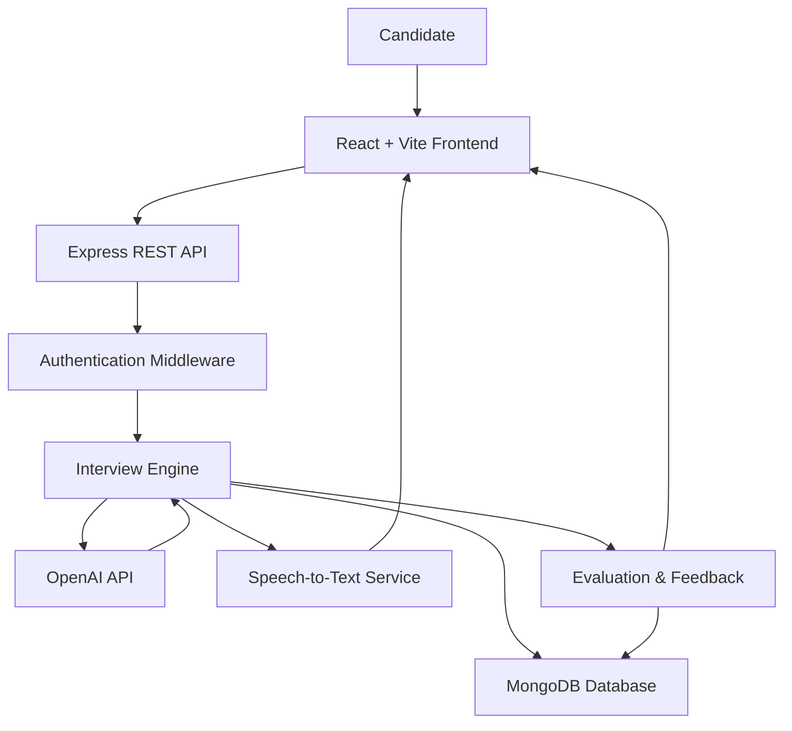
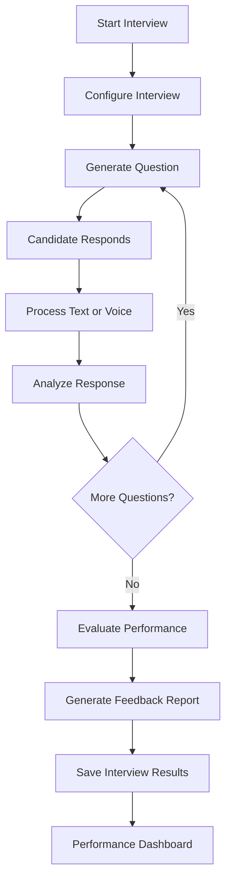
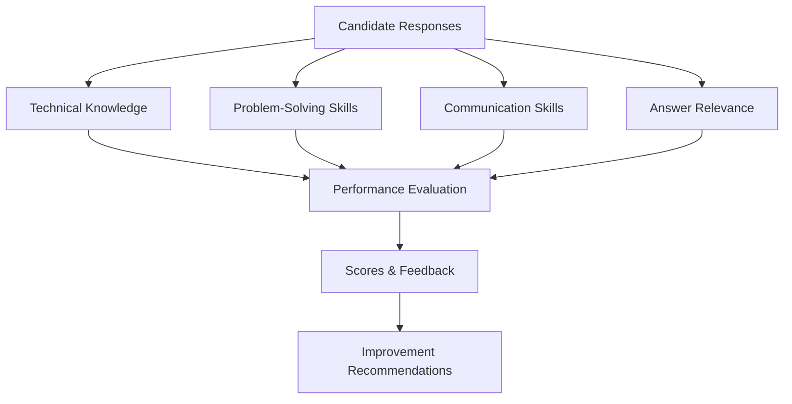

# GitHired — AI-Powered Real-Time Interview Platform

<p align="center">
  <strong>Practice interviews with AI. Get evaluated. Track your improvement.</strong>
</p>

<p align="center">
  
  
  
  
  
  
</p>

---

## 🚀 Overview

**GitHired** is a full-stack AI-powered interview platform designed to simulate realistic technical and behavioral interviews.

It combines AI-driven question generation, contextual follow-up questions, voice and text interaction, candidate response evaluation, and structured feedback to help users practice interviews and track their performance.

## ✨ Features

* 🤖 AI-powered technical and behavioral interviews
* 🧠 Dynamic and context-aware question generation
* 🔄 Adaptive follow-up questions based on candidate responses
* 🎙️ Voice and text-based interview interaction
* 📝 Speech-to-text transcription
* 📊 AI-based response evaluation and scoring
* 💬 Structured feedback and improvement suggestions
* 📈 Interview history and performance tracking
* 🔐 Authentication and protected routes
* 💾 Interview and feedback data persistence

> **Note:** Feature availability depends on the current implementation. Update this list to reflect the functionality that is actually working in your application.

## 🏗️ System Architecture



## 🔄 Interview Workflow



## 📊 Evaluation Framework

Candidate responses can be evaluated across multiple dimensions:



## 🛠️ Tech Stack

| Layer            | Technologies                            |
| ---------------- | --------------------------------------- |
| Frontend         | React 18, Vite, React Router DOM, Axios |
| Backend          | Node.js, Express.js                     |
| Database         | MongoDB, Mongoose                       |
| AI Integration   | OpenAI API                              |
| Voice Processing | Speech-to-Text / Whisper                |
| Authentication   | JWT                                     |
| Styling          | Custom CSS                              |
| API Architecture | REST API                                |

## 📂 Project Structure

```text
GitHired/
├── frontend/
│   └── src/
│       ├── components/
│       ├── pages/
│       ├── services/
│       ├── hooks/
│       └── utils/
├── backend/
│   ├── controllers/
│   ├── models/
│   ├── routes/
│   ├── middleware/
│   ├── services/
│   └── config/
└── README.md
```

*The structure above is illustrative. Adjust it to match your actual repository.*

## ⚡ Getting Started

### Prerequisites

* Node.js and npm
* MongoDB instance
* OpenAI API key, if using OpenAI-powered features

### 1. Clone the Repository

```bash
git clone https://github.com/YOUR_USERNAME/GitHired.git
cd GitHired
```

Replace `YOUR_USERNAME/GitHired` with your actual GitHub repository path.

### 2. Set Up the Frontend

```bash
cd frontend
npm install
npm run dev
```

### 3. Set Up the Backend

Open a separate terminal:

```bash
cd backend
npm install
npm run dev
```

Ensure both development servers are configured to communicate with each other.

### 4. Configure Environment Variables

Create a `.env` file in the backend directory:

```env
PORT=5000
MONGODB_URI=your_mongodb_connection_string
JWT_SECRET=your_secure_jwt_secret
OPENAI_API_KEY=your_openai_api_key
```

Add any additional environment variables required by your implementation. Never commit API keys, database credentials, or other secrets to version control.

## 🛣️ Development Roadmap

* [x] Frontend interview interface
* [x] Feedback interface
* [ ] Complete AI interview orchestration
* [ ] Context-aware follow-up questions
* [ ] Voice interview integration
* [ ] Persistent interview history
* [ ] Performance analytics dashboard
* [ ] Production deployment

*Update the checklist as features are implemented and tested.*

## 🎯 Core AI Pipeline

```text
Interview Configuration
         ↓
Question Generation
         ↓
Candidate Response
         ↓
Response Processing
         ↓
AI Evaluation
         ↓
Scoring & Feedback
         ↓
Performance Tracking
```

## 🔮 Future Enhancements

* Personalized interview difficulty
* Role-specific interview preparation
* Detailed performance analytics
* Interview session summaries
* Improved speech recognition
* Personalized learning recommendations

## 📜 License

This project is developed for educational and portfolio purposes. Add a specific open-source license if you intend to permit reuse, modification, or redistribution.

---

<p align="center">
  <strong>GitHired — Practice Smarter. Interview Better.</strong>
</p>
